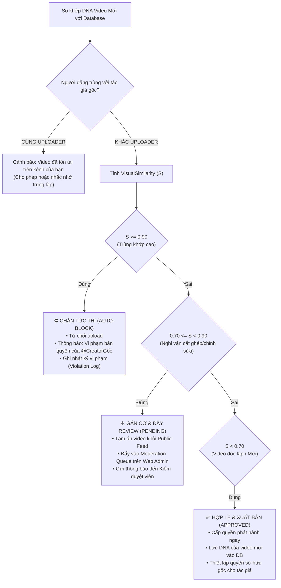

# 📋 KẾ HOẠCH PHÁT TRIỂN HỆ THỐNG NHẬN DIỆN BẢN QUYỀN TỰ ĐỘNG & KIỂM DUYỆT VIDEO
## Dự án: TopTop (TikTok Clone Ecosystem) - Giai đoạn: 08/10 → 16/10

---

## 📌 1. Bối Cảnh & Mục Tiêu Dự Án

Trong hệ sinh thái mạng xã hội video ngắn TopTop, việc bảo vệ quyền tác giả của người sáng tạo nội dung (Content Creator) và duy trì chất lượng hệ sinh thái nội dung (đặc biệt là mảng video nông nghiệp & thương mại nông sản) đóng vai trò sống còn. 

### Mục tiêu cốt lõi:
1. **Phân loại & Kiểm duyệt nội dung bằng AI (Người 1 - Gemini AI):** Tự động nhận diện video thuộc chủ đề Nông nghiệp hay phi nông nghiệp, phát hiện nội dung độc hại/spam, xuất metadata chuẩn hóa cho giỏ hàng.
2. **Ngăn chặn Re-upload & Bảo vệ Bản quyền tự động (Người 2 - Video Fingerprint DNA):** Xây dựng vân tay số (Fingerprint/DNA) cho video để phát hiện tức thì các hành vi sao chép, re-upload trái phép, lách bản quyền (cắt ghép, đổi tốc độ, lọc màu) và ra quyết định xử lý tự động (Cho phép / Cảnh báo / Chặn / Đẩy Moderator duyệt).
3. **Thương mại hóa Nông sản thông minh (Người 3 - Giỏ hàng & UI Nông nghiệp):** Gắn kết video nông nghiệp hợp lệ với luồng mua sắm nông sản trực tiếp trên ứng dụng.

---

## 🗺️ 2. Luồng Vận Hành Cốt Lõi (Architecture Flow)

```
                            [ USER TẢI LÊN VIDEO MỚI ]
                                         │
                                         ▼
                 ┌──────────────────────────────────────────────┐
                 │          NGƯỜI 1: AI / GEMINI ENGINE         │
                 │  - Trích xuất Keyframes & Audio context      │
                 │  - Phân loại: Nông nghiệp vs Ngoài luồng     │
                 │  - Kiểm duyệt an toàn (NSFW, bạo lực, spam)   │
                 │  - Đánh giá chất lượng & độ tin cậy          │
                 └───────────────────────┬──────────────────────┘
                                         │
                         Output: Metadata JSON chuẩn hóa
                                         │
                                         ▼
                 ┌──────────────────────────────────────────────┐
                 │     NGƯỜI 2: VIDEO FINGERPRINT / DNA ENGINE  │
                 │  - Trích xuất Level 1: MD5/SHA256 File Hash  │
                 │  - Trích xuất Level 2: Perceptual Hash pHash │
                 │  - Trích xuất Level 3: Audio Fingerprint     │
                 │  - Truy vấn Index trong DB `video_fingerprints`│
                 └───────────────────────┬──────────────────────┘
                                         │
                               So khớp độ tương đồng
                                         │
                         ┌───────────────┴───────────────┐
                         ▼                               ▼
                 [ KHÔNG TRÙNG KHỚP ]         [ CÓ KHẢ NĂNG RE-UPLOAD ]
                 (Similarity < 70%)              (Similarity >= 70%)
                         │                               │
                         ▼                               ▼
                 ┌───────────────┐               ┌───────────────┐
                 │   HỢP LỆ &    │               │ XỬ LÝ BẢN     │
                 │  CHO PHÉP     │               │ QUYỀN TỰ ĐỘNG │
                 └───────┬───────┘               └───────┬───────┘
                         │                               │
        ┌────────────────┴──────────────┐      ┌─────────┴─────────┐
        ▼                               ▼      ▼                   ▼
 [Ghi nhận DNA]                  [Nếu Nông nghiệp] [70% - 89%: Nghi vấn] [>= 90%: Trùng cao]
 Lưu bản quyền gốc                Kích hoạt giỏ hàng  Cảnh báo người dùng   Chặn upload ngay
 cho Creator vào DB               Người 3 (Shop UI)  Đẩy Admin Web duyệt  Khóa tính năng re-up
```

---

## 📅 3. Kế Hoạch Triển Khai Chi Tiết Theo Ngày (08/10 → 16/10)

| Ngày | Người 1 (AI / Gemini Nhận diện) | Người 2 (Bản quyền & Fingerprint) | Người 3 (Giỏ hàng & UI Nông nghiệp) | Mốc Đồng Bộ & Tích Hợp |
| :--- | :--- | :--- | :--- | :--- |
| **08/10** | • Khởi tạo Gemini 1.5/2.0 Flash SDK.<br>• Thiết kế System Prompt nhận diện video nông nghiệp.<br>• Định nghĩa cấu trúc Schema JSON đầu ra. | • Nghiên cứu thuật toán pHash & dHash cho video.<br>• Thiết kế cấu trúc bảng dữ liệu `video_fingerprints` trên Firestore.<br>• Xác định ma trận ngưỡng xử lý (Decision Matrix). | • Phân tích giao diện Feed hiện tại.<br>• Thiết kế Wireframe/Figma UI tab Nông nghiệp.<br>• Thiết kế luồng dữ liệu Giỏ hàng (Cart State). | **Thống nhất Data Contract** giữa Người 1 & Người 2. Thống nhất mô hình sản phẩm Người 3. |
| **09/10** | • Thử nghiệm Prompt với dataset mẫu (50 video nông nghiệp + 50 video đời sống/khác).<br>• Hiệu chỉnh few-shot learning để tối ưu độ chính xác. | • Viết module trích xuất 5 Keyframes cố định (10%, 30%, 50%, 70%, 90%).<br>• Tính 64-bit pHash cho từng frame.<br>• Viết hàm lưu thông tin bản quyền của video gốc. | • Xây dựng `CartNotifier` (Riverpod).<br>• Code chức năng Thêm vào giỏ (Add to Cart), Xóa, Tăng/Giảm số lượng.<br>• Lưu trữ cục bộ với `SharedPreferences`. | Test trích xuất fingerprint độc lập và kiểm tra latency sinh hash. |
| **10/10** | • Chuẩn hóa JSON Parser và xử lý ngoại lệ khi AI timeout/lỗi mạng.<br>• Thêm điểm số `confidence_score` (0.0 -> 1.0) và cờ `is_agriculture`. | • Xây dựng hàm tính khoảng cách Hamming (Hamming Distance).<br>• Viết logic so sánh DNA video mới với toàn bộ kho DNA đã lưu.<br>• Tính điểm `visual_similarity_score`. | • Viết logic tính tổng tiền (Subtotal, Giảm giá, Ship).<br>• Kết nối Firestore collection `agricultural_products`.<br>• Hoàn thiện màn hình Danh sách Giỏ hàng. | Hoàn thành độc lập 3 module logic lõi. |
| **11/10** | • Tích hợp service AI vào luồng chuẩn bị đăng video trên Mobile (Flutter/Android).<br>• Gửi thumbnail/keyframe lên Gemini trước khi xác nhận. | • **Tích hợp kết quả của Người 1:** Nhận JSON phân tích để kết hợp trọng số AI vào công thức tính Risk Bản quyền.<br>• Tạo service `CopyrightVerificationService`. | • Refactor giao diện khu vực Nông nghiệp (Tab Nông Nghiệp Xanh).<br>• Thiết kế badge nhận diện video nông sản trên Feed. | **Ghép nối Tầng 1 (AI) sang Tầng 2 (Bản quyền)** trong luồng upload. |
| **12/10** | • Chạy kiểm thử trên tập video đa dạng (ảnh mờ, góc quay nghiêng, video ngắn 3s, video dài 60s).<br>• Đo thời gian phản hồi (Latency benchmark < 2s). | • Xây dựng đầy đủ 3 nhánh quyết định:<br>  + `< 70%`: Xuất bản & Lưu DNA.<br>  + `70-89%`: Gắn cờ `pending_review`, đẩy lên Web Admin.<br>  + `>= 90%`: Báo lỗi bản quyền, chặn publish. | • Hoàn thiện UI thẻ Sản phẩm Nông nghiệp (Product Card).<br>• Trang chi tiết sản phẩm nông sản (Product Details Sheet).<br>• Bộ lọc danh mục (Rau củ, Trái cây, Hoa Đà Lạt). | Kiểm thử luồng phân nhánh quyết định tại Client & Backend. |
| **13/10** | • Đánh giá độ chính xác (Precision/Recall) của AI.<br>• Tinh chỉnh prompt để không nhận nhầm cảnh quan thường thành nông nghiệp. | • **Kiểm thử chuyên sâu các trường hợp lách luật:**<br>  + Video gốc 100%.<br>  + Video bị cắt 2s đầu/cuối.<br>  + Video lật ngang (flip mirror).<br>  + Video đổi bộ lọc màu hoặc nén giảm chất lượng. | • Kiểm thử toàn diện giỏ hàng (Cart edge-cases): Hết hàng, số lượng âm, giỏ hàng trống.<br>• Sửa lỗi UI tràn viền (overflow). | Họp đánh giá tỷ lệ False Positive (Bắt nhầm bản quyền). |
| **14/10** | • Kiểm thử toàn diện (End-to-End) module AI trong môi trường mạng yếu/offline. | • Hoàn thiện luồng khép kín: Phát hiện $\rightarrow$ Cảnh báo $\rightarrow$ Đẩy hàng đợi kiểm duyệt (`moderation_reports`) trên Web Admin. | • Kết nối dữ liệu nông sản thật từ Firestore.<br>• Gắn nút "Mua ngay nông sản trong video" trên Video Feed. | Test toàn trình (E2E): Tải video nông nghiệp $\rightarrow$ AI nhận diện $\rightarrow$ Kiểm tra bản quyền $\rightarrow$ Hiện giỏ hàng. |
| **15/10** | • Tối ưu hóa bộ nhớ, giải phóng bộ đệm ảnh keyframe.<br>• Fix các lỗi phân loại biên. Chuẩn bị kịch bản Demo. | • Xử lý trường hợp đặc biệt: Chính chủ đăng lại video của mình (`uploader_id` trùng nhau).<br>• Hoàn thiện thông báo UX thân thiện cho người dùng. | • Tinh chỉnh animation, haptic feedback khi thêm vào giỏ.<br>• Hoàn thiện toàn bộ trải nghiệm người dùng (UX Polish). | Freeze Code (Đóng băng mã nguồn), tập dượt kịch bản Demo trực tiếp. |
| **16/10** | • **Nghiệm thu AI:** Báo cáo tỷ lệ nhận diện chính xác, thời gian phản hồi thực tế. | • **Nghiệm thu Bản quyền:** Báo cáo khả năng chống re-upload trên các biến thể video. | • **Nghiệm thu E-Commerce:** Demo luồng lướt video nông nghiệp $\rightarrow$ bấm giỏ hàng $\rightarrow$ tạo đơn. | **TỔNG KẾT & DEMO DỰ ÁN TOÀN BỘ HỆ SINH THÁI.** |

---

## 🔬 4. Chi Tiết Kỹ Thuật Cơ Chế Bản Quyền & AI

### 4.1. Chuẩn Hóa Dữ Liệu Trao Đổi Giữa Người 1 và Người 2 (Data Contract)
Khi video được chọn tải lên, hệ thống trích xuất Keyframes và gửi cho **Gemini API**. Kết quả trả về bắt buộc phải tuân theo JSON Schema:

```json
{
  "video_id": "vid_temp_20261008_001",
  "is_agriculture": true,
  "confidence_score": 0.94,
  "category": "agriculture_horticulture",
  "detected_items": ["Dâu tây Đà Lạt", "Nhà kính", "Hái quả hữu cơ"],
  "content_summary": "Quy trình thu hoạch dâu tây giống Nhật tại nông trại Đà Lạt",
  "safety_assessment": {
    "is_safe": true,
    "nsfw_score": 0.01,
    "violence_score": 0.0,
    "spam_probability": 0.05
  },
  "commercial_intent": {
    "has_product_showcase": true,
    "recommended_category_id": "cat_fruits_fresh",
    "suggested_tags": ["#dautaydalat", "#nongnghiepsach", "#vietgap"]
  }
}
```

### 4.2. Cơ Chế Tạo Dấu Vân Tay Video (Video Fingerprint / DNA) của Người 2
Hệ thống sử dụng cơ chế **Vân Tay Thị Giác Đa Điểm (Multi-Keyframe Perceptual Hash):**
1. **Lấy mẫu (Sampling):** Trích xuất $N = 5$ khung hình (Keyframes) đại diện tại các vị trí $10\%, 30\%, 50\%, 70\%, 90\%$ của tổng thời lượng video.
2. **Tiền xử lý (Preprocessing):** Thu nhỏ mỗi keyframe về kích thước $32 \times 32$ pixel, chuyển sang thang độ xám (Grayscale).
3. **Biến đổi rời rạc (DCT - Discrete Cosine Transform):** Trích xuất ma trận tần số thấp $8 \times 8$ (nơi chứa đựng năng lượng cấu trúc hình ảnh, bất biến trước việc chỉnh màu hoặc nén bitrate).
4. **Sinh chuỗi Hash (pHash):** So sánh từng giá trị với trung vị (median) để tạo chuỗi nhị phân 64-bit ($H_1, H_2, H_3, H_4, H_5$).
5. **Video DNA:** Ghép $5$ chuỗi hash thành mã định danh quang học tổng hợp 320-bit:
   $$\text{DNA} = H_1 \parallel H_2 \parallel H_3 \parallel H_4 \parallel H_5$$

### 4.3. Công Thức Tính Độ Tương Đồng (Similarity Calculation)
Để so khớp Video Mới ($A$) với Video trong Cơ sở dữ liệu ($B$):
- Khoảng cách Hamming giữa cặp frame thứ $i$:
  $$D_i = \text{HammingDistance}(H_{A,i}, H_{B,i})$$
- Tỷ lệ tương đồng của frame thứ $i$:
  $$S_i = 1 - \frac{D_i}{64}$$
- Điểm tương đồng quang học trung bình:
  $$\text{VisualSimilarity}(A, B) = \frac{1}{5} \sum_{i=1}^{5} S_i$$

### 4.4. Ma Trận Quyết Định Bản Quyền Tự Động (Decision Matrix)



---

## 🗄️ 5. Cấu Trúc Dữ Liệu (Firestore Schema)

### Collection: `video_fingerprints`
```typescript
interface VideoFingerprint {
  fingerprint_id: string;        // Khóa chính
  video_id: string;              // Tham chiếu tới collection 'videos'
  original_author_id: string;    // ID người tạo đầu tiên
  created_at: Timestamp;
  duration_seconds: number;
  keyframes_phash: string[];     // Mảng 5 chuỗi hash 64-bit Hex
  audio_signature_hash?: string; // Hash phổ âm thanh (nếu có)
  is_agriculture: boolean;       // Kết quả từ Người 1
  ai_confidence: number;
}
```

### Collection: `copyright_moderation_queue`
```typescript
interface ModerationReport {
  report_id: string;
  suspect_video_id: string;
  suspect_uploader_id: string;
  original_video_id: string;
  original_author_id: string;
  similarity_score: number;      // 0.70 - 0.89
  ai_summary: string;
  status: 'pending' | 'approved' | 'rejected_and_taken_down';
  reviewed_by?: string;          // Admin / Moderator ID
  reviewed_at?: Timestamp;
}
```

---

## 🛡️ 6. Tiêu Chí Nghiệm Thu (Acceptance Criteria) Cho Từng Người

1. **Người 1 (AI Nhận diện):**
   - Tỷ lệ phân loại chính xác video nông nghiệp $\ge 92\%$.
   - Thời gian phân tích trung bình $\le 2.5$ giây cho mỗi video.
   - Luôn trả về định dạng JSON hợp lệ, có cơ chế fallback an toàn nếu mất mạng.

2. **Người 2 (Bản quyền tự động):**
   - Phát hiện chính xác $100\%$ video re-upload nguyên bản (Exact copy).
   - Phát hiện $\ge 85\%$ video bị chỉnh sửa nhẹ (lật gương, nén bitrate, đổi bộ lọc màu).
   - Tỷ lệ bắt nhầm (False Positive) đối với video độc lập $< 3\%$.
   - Tự động chặn và thông báo minh bạch cho người dùng vi phạm.

3. **Người 3 (Giỏ hàng & UI Nông nghiệp):**
   - UI tab Nông nghiệp mượt mà 60 FPS, chuẩn phong cách TikTok Shop.
   - Thao tác thêm vào giỏ, cập nhật số lượng tức thì, đồng bộ trạng thái không giật lag.
   - Hiển thị badge Nông sản và ghim sản phẩm chính xác dựa vào nhãn của Người 1.
